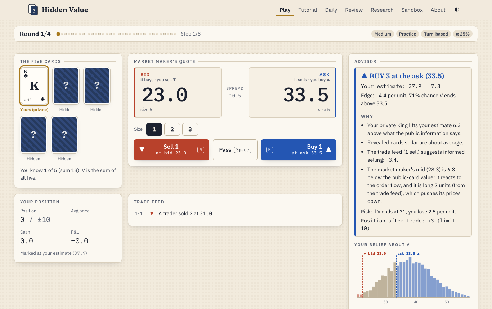
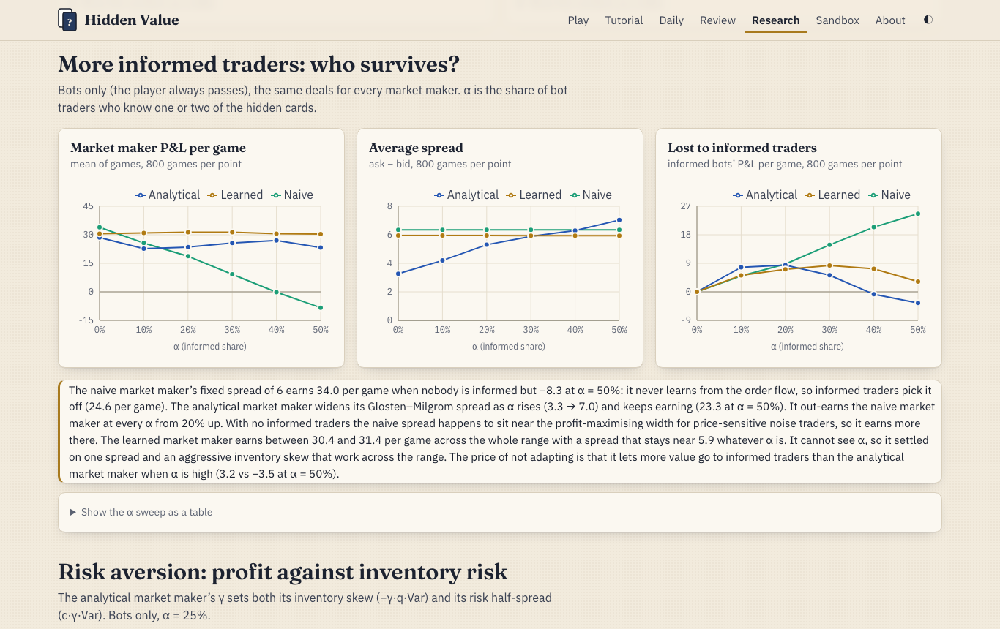

# Hidden Value — multiplayer edition

**A trading card game against an explainable AI market maker, running entirely in your browser, now with a multiplayer table for 2–4 people sharing one screen.**

**▶ Play it: https://khaja500.github.io/hidden-value-multiplayer/** (multiplayer: [#/multiplayer](https://khaja500.github.io/hidden-value-multiplayer/#/multiplayer))

This edition is the [original Hidden Value](https://github.com/Khaja500/hidden-value) (single-player, live at https://khaja500.github.io/hidden-value/) plus multiplayer. It is developed on the `multiplayer` branch of the original repo and published from this repo; everything single-player works exactly as in the original.



The asset is worth the sum of five face-down cards. An AI market maker always shows a **bid** (the price it buys at) and an **ask** (the price it sells at). You see one card it doesn't. An **Advisor** tells you, with numbers, when to buy at the ask, sell at the bid, or hold, and why. After every game a **Review** opens up the market maker's reasoning for every price it set. A **Research** page shows simulation results for all of it.

No real money, and no account needed: the game engine, particle filters and simulations all run client-side in TypeScript, and the site is deployed to GitHub Pages by GitHub Actions. An optional free account (email and password) saves your game history and lets you [play friends online](#online-play-and-accounts).

## How to play

- **The asset:** 5 cards dealt face down, Ace = 1 … King = 13. The value **V** is their sum (35 on average, SD about 8).
- **What you see:** 1 private card (2 on Easy). Rounds 2, 3 and 4 each start by turning one more card face up for everyone.
- **Each step** (8 per round): one computer trader arrives and trades or passes (some are _informed_ and know 1–2 cards), the market maker requotes, then you may **buy 1–3 at the ask**, **sell 1–3 at the bid**, or pass.
- **Settlement:** long units earn V − price, short units earn price − V. **Score = your P&L.** The **skill score** subtracts what the Advisor bot made on the same deal, so it cancels out the luck of the cards.
- **Limits:** your position stays within ±10; the market maker's within ±25.
- **Keyboard:** `B` buy · `S` sell · `1` `2` `3` size · `Space` pass · `A` ask the Advisor.

| Table  | Your cards | Informed traders | Market maker                                            |
| ------ | ---------- | ---------------- | ------------------------------------------------------- |
| Easy   | 2          | 10%              | Naive: fixed spread of 6 around the public-card average |
| Medium | 1          | 25%              | Analytical (below); ignores your trades                 |
| Hard   | 1          | 35%              | Analytical, and it learns from your trades              |
| Expert | 1          | 35%              | Learned: a neural policy trained by simulation          |

## Multiplayer (one screen)

- **2–4 players** share one device. Each holds a different one of the five cards: player 1 the first position, player 2 the second, and so on. Any of the four tables can be used, with one card per player.
- **Each step:** one bot trades, then every player trades once, in turn. The market maker requotes after each of them, and the first player rotates every step so nobody always gets the freshest price.
- **Privacy:** between turns a hand-off screen hides everything private. The next player taps **Show my card** (or presses Enter). Their card hides again the moment they act, or with Esc.
- **Reveals** use cards nobody holds first. With 3 players there are only 2 such cards, so round 4 reveals a random player's card; with 4 players, rounds 3 and 4 do.
- **Reading each other:** every trade is in the feed with the player's name. On Hard, the market maker learns from every player's trades, each modelled with that player's own card position. Each player's Advisor (optional, counted as hints) reads the bots' flow but not the other players.
- **Results:** best P&L wins. Each trade is graded by its expected profit at the time, from that player's own estimate, so the results separate skill ("expected") from luck. Then a rematch on a new deal, or a replay of the same deal.

## Online play and accounts

- **Accounts:** sign up with an email and password on the [Account page](https://khaja500.github.io/hidden-value-multiplayer/#/account). Every game you finish while signed in (practice, daily, tutorial, online) is saved to your history, which you can see, and review, on any device.
- **Online tables:** open a table on the [Online page](https://khaja500.github.io/hidden-value-multiplayer/#/online), send friends the 6-letter code or invite link, and deal when 2–4 players are in. Each of you plays on your own device, with the same rules as one-screen multiplayer. Your card is always on your screen, there are no hand-offs, and you can pass for a player who has gone quiet for 60 s.
- **Nobody can peek:** online, only a small game server (Cloud Run) knows the deal. Each browser can read the public table and its own card, enforced by Firestore security rules. The server rebuilds the game from its move list on every move and grades the results the same way as one-screen play.
- **Free to run:** everything stays inside Google Cloud's free tier, and a budget-triggered function disconnects billing if the project ever costs more than ₹0. Details, limits and deploy commands are in [docs/ONLINE.md](docs/ONLINE.md).

Modes: **Tutorial** (guided first game with an interactive Glosten–Milgrom example), **Practice** (any table; Advisor on demand; turn-based or timed), **Daily challenge** (the same deal for everyone each UTC day, no Advisor, local leaderboard), **Review** (after every game), **Sandbox** (run your own simulations), **Research**.

## How it works

- **Beliefs: a particle filter** over the hidden cards (5,000 particles in typed arrays). Each trade reweights deals by its likelihood: an informed trader buys only if its valuation is above the ask, and those valuations come from a precomputed lookup table. Reveals redraw inconsistent particles with full-history importance weights. A trade update takes about 0.4 ms.
- **The analytical market maker** builds every quote from named parts: **fair value** from the filter; a **Glosten–Milgrom adverse-selection spread** (ask = E[V | next trader buys]); an **Avellaneda–Stoikov-style inventory skew** −γ·q·Var(V); and a **risk half-spread** c·γ·Var(V). The parts plus tick rounding add up exactly to the posted quote, and its "what if" counterfactuals are checked against real replays.
- **The Advisor** sees only your `PlayerView`, a rule enforced by the types and by a test that scrambles everything you can't see in 500 states and checks the advice doesn't change. It recommends BUY/SELL when the edge exceeds θ·SD **and** the probability of profit is at least p_min (θ = 0.15, p_min = 0.65, tuned on validation deals). It sizes trades by edge ÷ variance. It explains itself by recomputing your estimate with your private card, or the order flow, removed.
- **The learned market maker** (Expert) is a 16-unit MLP trained with the **Cross-Entropy Method** to maximise P&L − λ·inventory². It is explained by a distilled linear model (fidelity R² 0.95), partial-dependence plots and permutation importance.

## Research highlights

All numbers are from `npm run sim` / `npm run train`, on held-out test deals (tuning used separate validation deals). Full charts are on the [Research page](https://khaja500.github.io/hidden-value-multiplayer/#/research).



- **The beliefs are calibrated:** over 2,000 games, 10/10 decile buckets of the predicted value are within their 95% interval for both the market maker's and the player's view. So are 15 of 16 buckets of stated probabilities.
- **Following the Advisor makes money** (mean P&L per game, 95% CI, 2,000 games each): Easy **+17.5 ± 1.8**, Medium **+12.0 ± 1.3**, Hard **+7.4 ± 0.9**, Expert **+9.9 ± 1.3**.
- **Adverse selection is real:** as the informed share rises from 0% to 50%, the naive market maker goes from +34.0 to −8.3 per game. The analytical one widens its spread (3.3 → 7.0) and stays at +23 to +29.
- **Explanations are faithful:** 1,889 / 1,889 counterfactual quotes matched a real replay. Removing each component produced the effect its explanation claims (no skew: inventory 3.6 → 5.4 and P&L SD 46 → 74; no adverse-selection spread: losses to informed traders 7.2 → 17.6). The Advisor's private-card effect matches an independent recompute within 0.5 in 98% of states.
- **The learned market maker rediscovered inventory skew** (−0.82 per unit at the start, against −0.65 for the analytical rule) and **a spread that narrows as cards are revealed**. It did **not** rediscover Glosten–Milgrom widening on one-sided flow: its spread is asymmetric, and it protects itself by moving its centre instead. It earns +30 to +31 per game at every α, more than the analytical MM throughout, mostly by using its skew to turn noise traders into a hedge.
- **Some results cut against the design and are reported as such:** underestimating α by half _raises_ the analytical MM's profit while overestimating it cuts profit sharply, and a higher γ than the game uses would earn slightly more (at the cost of a spread too wide to be fun).

Design choices and their reasons are in [docs/DECISIONS.md](docs/DECISIONS.md); the full rules are in [docs/RULES.md](docs/RULES.md).

## Run it locally

```bash
npm install
npm run dev          # http://localhost:5173/hidden-value-multiplayer/
npm test             # unit + property tests (Vitest, fast-check)
npm run e2e          # Playwright: full games in a real browser
npm run lint && npm run typecheck
npm run bench        # particle-filter update times (30 ms budget)
npm run sim -- --exp all      # every research experiment → public/research/*.json
npm run train                 # retrain the learned market maker → public/models, src/agents
```

Experiments run on all CPU cores with worker threads; the full set takes about 10 minutes on an M1 laptop.

## Project structure

```
src/engine/    cards, seeded RNG, events, rules, full state, views (information boundaries), game drivers (single-player and multiplayer)
src/belief/    particle filter, informed-trader likelihoods, calibration
src/agents/    noise and informed bots, naive / analytical / learned market makers, Advisor, Advisor bot
src/explain/   quote explanations, counterfactual replays, attribution, review, lessons, text rendering
src/sim/       headless simulation, research checks, CEM training helpers, Sandbox runs
src/workers/   Web Worker for reviews, skill scores and the Sandbox
src/online/    accounts and online play: room transitions (pure), packed public view, history, server client, Firebase setup
src/store/     Zustand stores (single-player holds only the PlayerView; multiplayer holds public info plus the current player's view during their turn), settings, safe localStorage
src/pages/     Home, Play, Multiplayer (Party.tsx), Online, Account, Tutorial, Review, Daily, Research, Sandbox, About
server/        the online game server (Node on Cloud Run): verifies sign-ins, runs src/online/rooms.ts in Firestore transactions
infra/         billing-guard: disconnects billing when the budget reports any spend
firestore.rules  who can read and write what
scripts/       sim.ts, train.ts, bench.ts (Node + tsx, worker-thread pool)
tests/         zero-sum, replay, calibration, decomposition, counterfactual, no-cheat, UI no-leak, multiplayer, e2e
```

## Tech stack

TypeScript (strict) · React 19 · Vite 8 · Zustand · Recharts · Web Workers · Vitest + fast-check · Playwright · ESLint + Prettier · GitHub Actions · GitHub Pages · Firebase Auth + Firestore · Cloud Run.

## License

MIT
